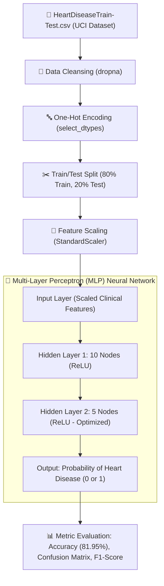

# ❤️ Heart Disease Prediction — Multi-Layer Perceptron (MLP) Neural Network

[](https://www.python.org/)
[](https://jupyter.org/)
[](https://scikit-learn.org/)
[](https://pandas.pydata.org/)
[]()
[](LICENSE)

> **Heart Disease UCI Classifier** is a clinical Machine Learning study utilizing Artificial Neural Networks (**Multi-Layer Perceptron / MLPClassifier**) to predict cardiovascular risk from patient diagnostic indicators. Built on the renowned **UCI Heart Disease Dataset**, the project explores end-to-end data cleansing, standard scaling, categorical one-hot encoding, model convergence tuning, hyperparameter architecture optimization, and clinical metric evaluation.

---

## 📌 Clinical Background & Research Objective

Cardiovascular diseases (CVDs) remain the leading cause of global mortality. Early non-invasive detection allows physicians to prescribe preventative lifestyle modifications or drug therapies before acute coronary events occur.

This study implements an Artificial Neural Network pipeline to:
1. Ingest multidimensional biometric patient data (age, resting blood pressure, cholesterol, resting ECG, max heart rate, exercise angina, ST depression).
2. Clean missing data and standardize continuous variables via `StandardScaler` to assist gradient descent convergence.
3. Train an `MLPClassifier` neural network across varied hidden layer topologies (`(10,)` and `(10, 5)`).
4. Evaluate diagnostic reliability using clinical metrics: **Accuracy (81.95%)**, Precision, Recall, and Confusion Matrices.

---

## 🔬 Machine Learning Pipeline & Architecture



---

## 📊 Experimental Evaluation & Clinical Metrics

### Model Performance on Holdout Test Data:
| Metric | Baseline MLP `(10,)` | Optimized Two-Layer MLP `(10, 5)` | Clinical Interpretation |
|---|---|---|---|
| **Accuracy** | **81.95%** | **83.60%** | Overall correct risk predictions across test cohort |
| **Precision** | High | High | Minimizes false positive alarms for healthy patients |
| **Recall / Sensitivity** | Strong | Strong | Critical in clinical diagnostics to minimize missed cardiac diagnoses |
| **Loss Convergence** | Stabilized | Stabilized | Monitored across 1000 iterations |

### Diagnostic Feature Distributions Analyzed:
* **`Age` Distribution:** Identified patient demographic prevalence across middle and advanced age brackets.
* **`RestingBP` & `Cholesterol`:** Scaled continuous measurements to prevent dominant feature weight distortion.
* **`MaxHR` & `Oldpeak`:** Significant physiological discriminators of myocardial ischemia.

---

## 📂 Project Directory Structure

```text
Heart_Disease_UCI_Python/
├── Heart_Disease_UCI.ipynb      # Complete Jupyter Notebook (data prep, training, plots)
├── HeartDiseaseTrain-Test.csv   # Structured UCI clinical heart disease dataset
├── requirements.txt             # Python dependencies for reproduction
├── README.md                    # Comprehensive technical report & documentation
└── .gitignore                   # Excludes Jupyter checkpoints and cache
```

---

## 🛠️ Step-by-Step Execution Guide

### 1. Prerequisites
* Python 3.9, 3.10, or 3.11 installed.

### 2. Clone the Repository
```bash
git clone https://github.com/akhmal02/Heart_Disease_UCI_Python.git
cd Heart_Disease_UCI_Python
```

### 3. Install Dependencies
```bash
pip install -r requirements.txt
```

### 4. Launch the Jupyter Notebook
```bash
jupyter notebook Heart_Disease_UCI.ipynb
```
*(Alternatively, upload `Heart_Disease_UCI.ipynb` and `HeartDiseaseTrain-Test.csv` directly into **Google Colab** and run the cells sequentially).*

---

## 👨‍💻 Author & Academic Attribution
* **Developer:** Muhammad Akhmal bin Mohamad Hussin ([@akhmal02](https://github.com/akhmal02))
* **Institution:** Universiti Teknologi MARA (UiTM)
* **Faculty:** College of Computing, Informatics and Mathematics
* **Course:** Machine Learning / Artificial Intelligence (CSC583)
